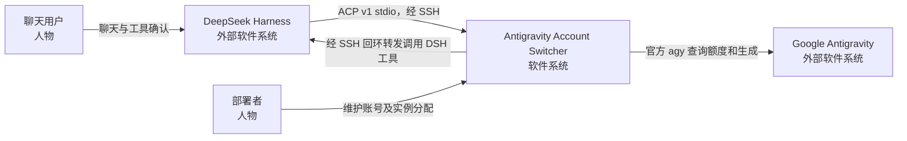
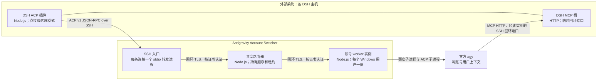
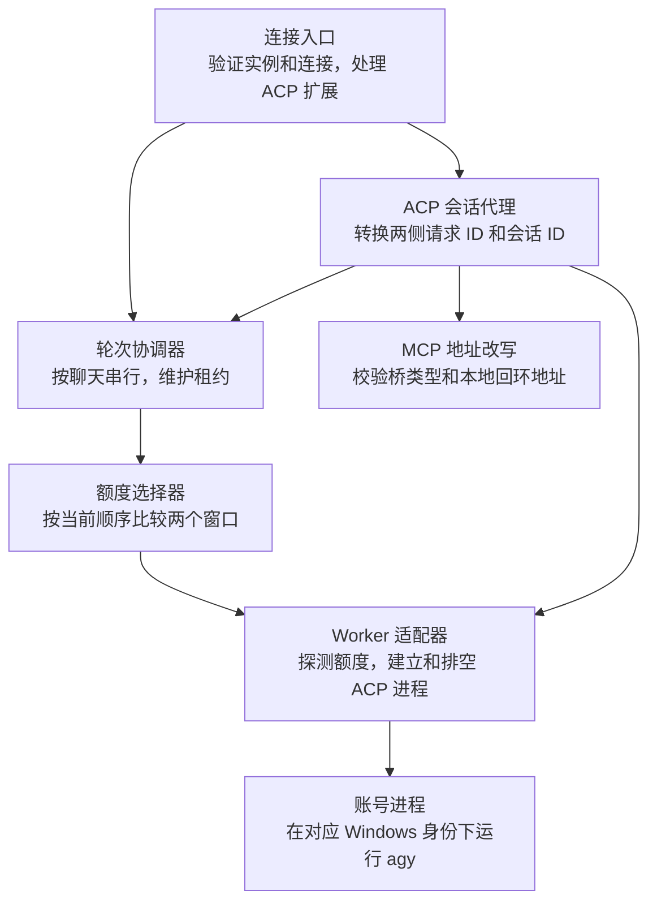
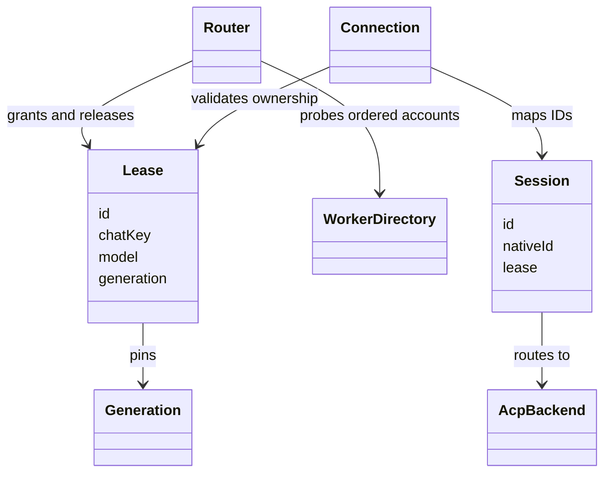
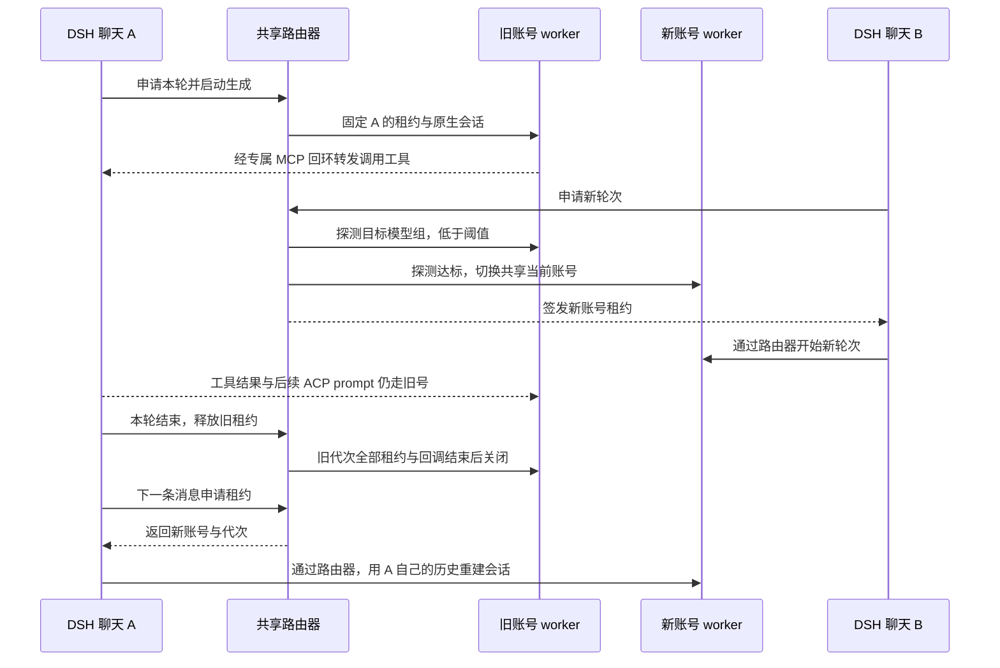
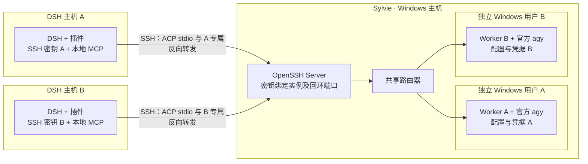

# 架构：C4

[官方 C4 模型](https://c4model.com/diagrams) 用四种缩放层级描述静态结构；本文件另附动态和部署视图。以下描述共享路由器、账号 worker 与客户端接入契约。Windows 双账号及跨主机行为仍按部署手册验收。

## L1 · 系统上下文

DSH 可由 QQ 或其他入口调用。DSH 拥有聊天历史、工具执行与用户权限提示；Switcher 拥有账号选择、租约与 ACP 转发；Google 拥有认证、模型和真实额度。

## L2 · 容器

SSH 公钥对应一个配置的 DSH 实例及其回调端口。入口从服务端绑定取得实例身份；来自客户端的标识只用于关联诊断。每条 ACP 连接的请求、回复、更新、取消和权限确认均归属该连接。Worker 只执行服务端允许的 agy 命令；客户端路径不得变成 worker 的任意工作目录。

## L3 · 路由器组件

| 组件 | 约束 |
| --- | --- |
| 额度选择器 | 显式匹配模型组。两个窗口都要返回有效的 0–1 比例，`min(weekly, fiveHour) >= threshold` 才可用；探测失败不能当作低额度。整圈无可用且至少一次探测失败时，报探测错误。 |
| 轮次协调器 | 同一连接内，同一聊天与用途只有一个活跃租约。更新共享当前账号和分配租约是同一次决定；租约持有具体账号进程代次，随后其他聊天切号不改变它。 |
| ACP 会话代理 | 保存代理会话与原生会话的绑定。双向 RPC 分别转换请求 ID，转换引用请求的取消消息；权限结果只可回到发起连接和会话。 |
| MCP 地址改写 | 只将允许的回环桥地址改为该实例预先分配的 Sylvie 回环地址；原路径、会话鉴权保留。DSH 使用 agy 原生会话 ID 校验工具，继续用代理会话 ID 处理 ACP。 |
| Worker 适配器 | 额度探测与 ACP 在同一实际 Windows 身份和配置下运行；旧代次进入排空后，已有租约与回调全部结束才关闭。 |

## L4 · 核心代码

- 客户端通过 `_antigravityAccountSwitcher/acquireTurn` 申请本轮，获得仅对本连接有效的租约、账号代次和选择结果；`_antigravityAccountSwitcher/releaseTurn` 在 DSH 轮次结束后释放。连接断开会取消并清理其租约；服务端须对重复释放保持幂等。
- `Session` 按 `(authenticatedInstance, connectionId, proxySessionId)` 查找。两侧 JSON-RPC 请求的编号空间独立，取消和权限请求使用对应方向的映射。
- ACP 规范之外的扩展必须显式协商。客户端把租约关联到会话创建和本轮请求，不把聊天历史放入额外的账号数据库。
- 无可用且确认全部耗尽时，代理可提供不启动 agy 的合成会话，按 `agent_message_chunk`、`stopReason: end_turn` 结束；插件仍走普通回复路径，并在之后真正选中账号时重建会话。

实现入口：[路由和租约](../src/router.ts) · [ACP 双向请求](../src/acp-backend.ts) · [回环 TLS 路由](../src/broker.ts) · [账号进程](../src/worker.ts)。

## 动态视图 · A 在旧号工具回调中，B 触发切号

## 部署视图 · Sylvie 与两台 DSH

协议与部署依据：[ACP stdio](https://agentclientprotocol.com/protocol/v1/transports) · [ACP 扩展](https://agentclientprotocol.com/protocol/v1/extensibility) · [ACP 回合](https://agentclientprotocol.com/protocol/v1/prompt-turn) · [官方 CLI ACP](https://antigravity.google/docs/cli/acp/) · [模型组额度](https://antigravity.google/docs/cli/commands/usage/) · [OpenSSH 转发限制](https://man.openbsd.org/sshd.8#permitlisten)。
